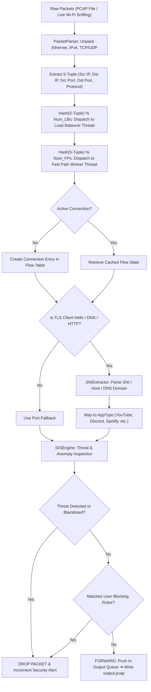
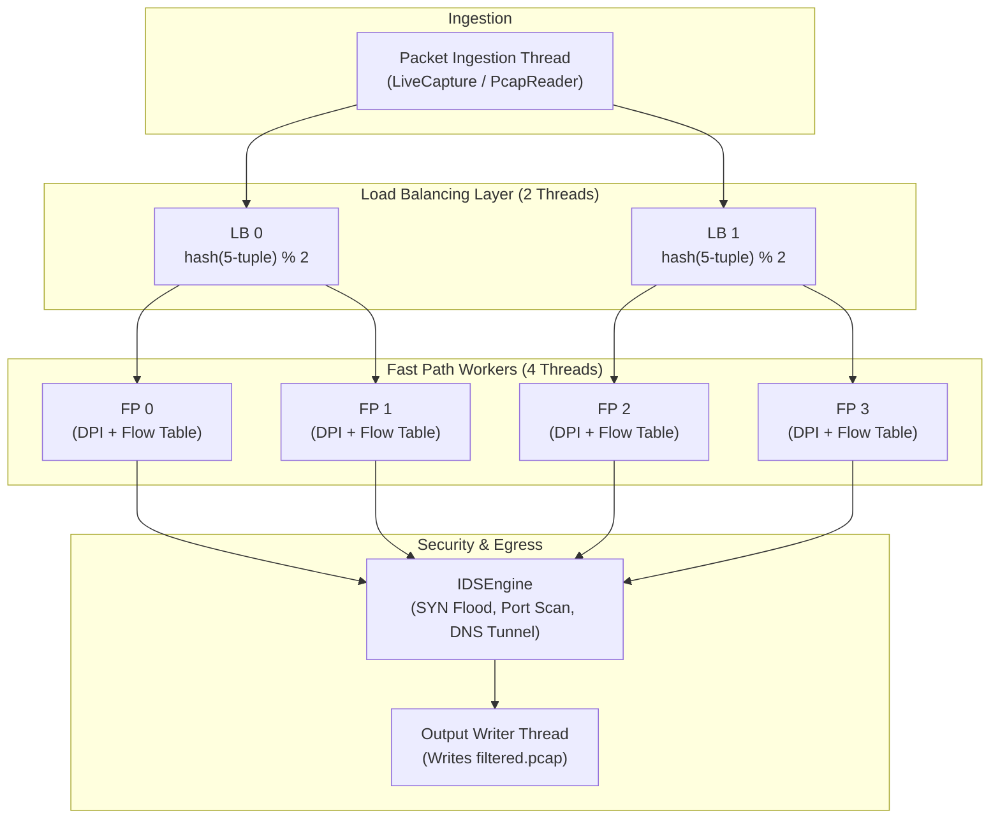

# 🛡️ Deep Packet Inspection (DPI) & Intrusion Prevention System (IPS)

[](https://en.wikipedia.org/wiki/C%2B%2B17)
[](https://github.com/Adityax2711/Deep-Package-inspection-System)
[](https://github.com/Adityax2711/Deep-Package-inspection-System)
[](https://github.com/Adityax2711/Deep-Package-inspection-System)
[](LICENSE)

A high-throughput, multi-threaded **Deep Packet Inspection (DPI)** engine and **Intrusion Detection/Prevention System (IDS/IPS)** written in modern C++17. The system decapsulates network protocols at line rate, identifies encrypted application protocols (HTTPS, TLS, DNS, HTTP, QUIC), sniffs live network traffic directly from hardware adapters, and detects cyber threats such as **SYN Floods**, **Port Scans**, and **DNS Tunneling** using Shannon Entropy.

---

## 📌 Table of Contents
- [Why DPI?](#-why-dpi)
- [System Architecture](#-system-architecture)
- [Key Features](#-key-features)
  - [1. Deep Application Classification (SNI Extraction)](#1-deep-application-classification-sni-extraction)
  - [2. Live Network Sniffing](#2-live-network-sniffing)
  - [3. Mini-IDS / IPS Security Suite](#3-mini-ids--ips-security-suite)
  - [4. High-Performance Multi-Threading](#4-high-performance-multi-threading)
- [Directory Structure](#-directory-structure)
- [Building the Project](#-building-the-project)
- [Usage & Examples](#-usage--examples)
- [Sample Output & Threat Reports](#-sample-output--threat-reports)
- [Contributing & License](#-contributing--license)

---

## 🔍 Why DPI?

Traditional firewalls only look at packet **headers** (IP addresses and Layer 4 ports). However, over **95% of modern Internet traffic runs over Port 443 (HTTPS)**. Traditional port-based filters cannot distinguish between YouTube, GitHub, Discord, or malicious command-and-control (C2) communication.

```
Traditional Firewall:
[192.168.1.100:54321 ➔ 142.250.185.206:443]  ==> "Just Port 443 / HTTPS" (Blind)

DPI Engine:
[192.168.1.100:54321 ➔ 142.250.185.206:443]  ==> "TLS Client Hello: www.youtube.com" (Identified!)
```

This engine performs **Deep Packet Inspection** by peeling the protocol headers like an onion, parsing the unencrypted **TLS Server Name Indication (SNI)**, HTTP `Host` headers, and DNS queries, applying stateful rules, and filtering traffic in real time.

---

## 🏗️ System Architecture

### 1. Packet Processing Pipeline


### 2. Multi-Threaded Load Balancing & Worker Model


> **Why Consistent 5-Tuple Hashing?**  
> All packets belonging to the same bidirectional flow are guaranteed to land on the **exact same Fast Path worker thread**. This eliminates cross-thread mutex contention on connection tracking tables, achieving near-linear multi-core scalability.

---

## ⚡ Key Features

### 1. Deep Application Classification (SNI Extraction)
- **TLS 1.2 / 1.3**: Parses the initial unencrypted TLS `Client Hello` handshake, parses the TLS extensions block, extracts extension `0x0000` (Server Name Indication), and extracts the target domain name.
- **HTTP**: Inspects plaintext `Host:` headers in HTTP/1.0 and HTTP/1.1 requests.
- **DNS**: Decodes UDP/TCP Port 53 DNS queries to identify accessed domains before connections start.
- **Supported Apps**: Google, YouTube, Facebook, Instagram, Twitter/X, Netflix, Amazon, Microsoft, Apple, WhatsApp, Telegram, TikTok, Spotify, Zoom, Discord, GitHub, and Cloudflare.

### 2. Live Network Sniffing
- **Native Windows Raw Sockets (`SIO_RCVALL`)**: Enables live promiscuous mode packet sniffing directly on Windows without requiring third-party drivers.
- **Dynamic Npcap / WinPcap Integration**: Seamlessly binds to `wpcap.dll` if installed.
- **Adapter Discovery**: Automatically lists active network cards with IP addresses, MAC addresses, and operational status.
- **Synthesized Framing**: Re-encapsulates raw socket IP frames into standard Ethernet II structures so downstream parsing is unified.

### 3. Mini-IDS / IPS Security Suite
- **SYN Flood & Port Scan Detection (`SynTracker`)**:
  - Implements a sliding time-window embryonic connection tracker.
  - Detects **Port Scanning** if an IP scans more than 12 distinct ports within 3 seconds.
  - Detects **SYN Flooding (DoS)** if an IP emits 40+ unacknowledged SYNs in 3 seconds.
  - **Auto-Blacklisting**: Instantly blacklists offending attacker IPs and drops all subsequent packets.
- **DNS Tunneling Detection (`DNSTunnelDetector`)**:
  - Calculates **Shannon Entropy**:
    $$H(X) = -\sum_{i=1}^{n} P(x_i) \log_2 P(x_i)$$
  - Normal domain names have an entropy between $2.0$ and $3.2$. Base64/Hex data exfiltration tunnels exhibit high entropy ($> 3.65$) and excessive label lengths ($> 24$ characters).
  - Flags and blocks covert C2 communication channels.
- **TCP Out-of-Order & Reassembly Engine (`TCPReassembler`)**:
  - Tracks sequence numbers, identifies gaps and retransmissions, buffers out-of-order chunks, and reconstructs contiguous byte streams.

### 4. High-Performance Multi-Threading
- Thread-safe non-blocking bounded queues with condition variables.
- Asynchronous output writer thread prevents disk I/O bottlenecks.
- Clean shutdown via `Ctrl+C` signal handling.

---

## 📁 Directory Structure

```text
Deep-Package-inspection-System/
├── include/                     # C++ Header Files
│   ├── connection_tracker.h     # Connection flow tracking state
│   ├── dpi_engine.h             # Modular orchestrator
│   ├── fast_path.h              # Fast path worker thread declarations
│   ├── ids_engine.h             # Mini-IDS/IPS: SYN flood, port scan, DNS tunnel
│   ├── live_capture.h           # Live packet capture (Raw Sockets / Npcap)
│   ├── load_balancer.h          # Consistent hash load balancer
│   ├── packet_parser.h          # Layer 2, 3, 4 protocol decapsulator
│   ├── pcap_reader.h            # Binary PCAP parser
│   ├── platform.h               # Portable endian byte-order conversion
│   ├── rule_manager.h           # IP, App, and Domain rule manager
│   ├── sni_extractor.h          # TLS SNI, HTTP Host, and DNS parser
│   ├── thread_safe_queue.h      # Lock-free / CV thread-safe queue
│   └── types.h                  # 5-Tuple, AppType, and Statistics structures
│
├── src/                         # C++ Implementation Files
│   ├── dpi_mt.cpp               # Multi-threaded standalone DPI + IDS Engine
│   ├── ids_engine.cpp           # Shannon Entropy & IDS algorithms
│   ├── live_capture.cpp         # Windows raw socket promiscuous capture
│   ├── packet_parser.cpp        # Protocol parsing implementation
│   ├── pcap_reader.cpp          # PCAP file reading implementation
│   ├── sni_extractor.cpp        # SNI and DNS extraction logic
│   └── types.cpp                # Helper routines & string mappings
│
├── CMakeLists.txt               # CMake Build Configuration
├── Dockerfile                   # Docker container configuration
├── generate_test_pcap.py        # Python script to generate normal DPI traffic
├── generate_security_test_pcap.py # Python script to generate attack vectors
├── test_dpi.pcap                # Sample traffic capture
├── test_security.pcap           # Sample threat traffic (Port scan, SYN flood, Tunnel)
├── WINDOWS_SETUP.md             # Detailed Windows compilation instructions
├── .gitignore                   # Git ignore rules
└── README.md                    # Project documentation
```

---

## 🛠️ Building the Project

### Prerequisites
- **C++ Compiler**: GCC 10+ (MinGW-w64 on Windows, or GCC on Linux) with C++17 support.
- **CMake**: Version 3.16 or higher (Optional).

### Build Option A: Direct Command-Line (Recommended)

#### On Windows (PowerShell / Command Prompt):
```powershell
g++ -std=c++17 -O2 -static -static-libgcc -static-libstdc++ -I include -o dpi_engine.exe src/dpi_mt.cpp src/ids_engine.cpp src/live_capture.cpp src/pcap_reader.cpp src/packet_parser.cpp src/sni_extractor.cpp src/types.cpp -lws2_32 -liphlpapi
```

#### On Linux / WSL:
```bash
g++ -std=c++17 -O2 -pthread -I include -o dpi_engine src/dpi_mt.cpp src/ids_engine.cpp src/live_capture.cpp src/pcap_reader.cpp src/packet_parser.cpp src/sni_extractor.cpp src/types.cpp
```

### Build Option B: Using CMake
```bash
mkdir build && cd build
cmake ..
cmake --build . --config Release
```

---

## 🚀 Usage & Examples

### 1. View Available Network Interfaces
Lists all physical, virtual, and Wi-Fi adapters:
```powershell
.\dpi_engine.exe --list-interfaces
```

### 2. Analyze a Pre-Recorded PCAP Capture
```powershell
.\dpi_engine.exe test_dpi.pcap output.pcap
```

### 3. Filter Specific Applications or IPs
Block YouTube and drop packets from a specific source IP:
```powershell
.\dpi_engine.exe test_dpi.pcap filtered.pcap --block-app YouTube --block-ip 192.168.1.50
```

### 4. Run Threat & Intrusion Detection Test
Analyze a capture containing Port Scans, SYN Floods, and DNS Tunneling:
```powershell
.\dpi_engine.exe test_security.pcap output_security.pcap
```

### 5. Live Network Sniffing (Promiscuous Mode)
> [!NOTE]  
> Live capture from real network cards requires opening your terminal as **Administrator** on Windows (or using `sudo` on Linux).

```powershell
# Sniff live on Wi-Fi and save filtered traffic to live_out.pcap
.\dpi_engine.exe --live Wi-Fi live_out.pcap --block-app TikTok

# Capture up to 100 packets and stop automatically
.\dpi_engine.exe --live 172.17.54.130 live_out.pcap --max-packets 100
```

---

## 📊 Sample Output & Threat Reports

### Application Breakdown Report
```text
╔══════════════════════════════════════════════════════════════╗
║                      PROCESSING REPORT                        ║
╠══════════════════════════════════════════════════════════════╣
║ Total Packets:                77                           ║
║ Total Bytes:                5738                           ║
║ TCP Packets:                  73                           ║
║ UDP Packets:                   4                           ║
╠══════════════════════════════════════════════════════════════╣
║ Forwarded:                    77                           ║
║ Dropped:                       0                           ║
╠══════════════════════════════════════════════════════════════╣
║                   APPLICATION BREAKDOWN                       ║
╠══════════════════════════════════════════════════════════════╣
║ HTTPS                39  50.6% ##########            ║
║ Unknown              16  20.8% ####                  ║
║ DNS                   4   5.2% #                     ║
║ Twitter/X             3   3.9%                       ║
║ HTTP                  2   2.6%                       ║
║ Discord               1   1.3%                       ║
║ Spotify               1   1.3%                       ║
║ YouTube               1   1.3%                       ║
║ Google                1   1.3%                       ║
║ GitHub                1   1.3%                       ║
╚══════════════════════════════════════════════════════════════╝
```

### IDS / IPS Real-Time Threat Alerts
```text
[IDS ALERT - PORT_SCAN]
  Source:      192.168.1.99
  Target:      192.168.1.1:21
  Details:     Scanned 12 distinct ports within 3s window
  Action:      BLOCKED (Source auto-blacklisted)

[IDS ALERT - SYN_FLOOD]
  Source:      10.0.0.88
  Target:      192.168.1.10:80
  Details:     Sent 40 unacknowledged SYNs in 3s window (possible DoS)
  Action:      BLOCKED (Source auto-blacklisted)

[IDS ALERT - DNS_TUNNELING]
  Source:      192.168.1.50
  Target:      DNS Server:53
  Details:     Abnormally long encoded label with high entropy (Domain: "aW5mb3NlY3VyaXR5ZGF0YTEyMzQ1Njc4OQ==...", Entropy: 5.24, MaxLabel: 36, TotalLen: 65)
  Action:      BLOCKED (Source auto-blacklisted)

╔══════════════════════════════════════════════════════════════╗
║                 IDS / IPS SECURITY REPORT                    ║
╠══════════════════════════════════════════════════════════════╣
║ Total Security Alerts:        3                              ║
║ Auto-Blacklisted Attackers:   3                              ║
║ TCP Out-of-Order Packets:     0                              ║
║ TCP Retransmissions:          1                              ║
║ TCP Stream Reassemblies:      0                              ║
╠══════════════════════════════════════════════════════════════╣
║ RECENT DETECTED THREATS:                                     ║
║ • [PORT_SCAN] 192.168.1.99    -> Scanned 12 distinct ports   ║
║ • [SYN_FLOOD] 10.0.0.88       -> Sent 40 unacknowledged SYNs ║
║ • [DNS_TUNNELING] 192.168.1.50 -> Abnormally long encoded... ║
╚══════════════════════════════════════════════════════════════╝
```

---

## 📄 License
This project is licensed under the MIT License - see the [LICENSE](LICENSE) file for details.

Developed by [Aditya Raj](https://github.com/Adityax2711).
